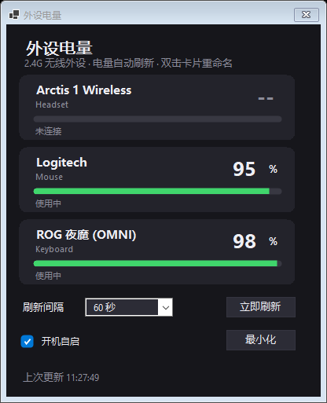
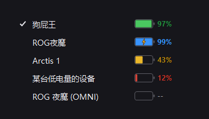
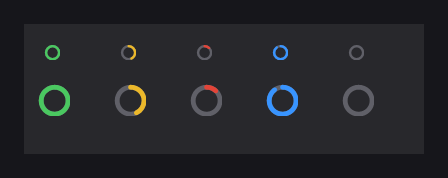

# BatteryTray — 外设电量托盘

Windows 托盘工具：实时显示 2.4G 无线外设（鼠标 / 键盘 / 耳机）的电量与充电状态，纯 WinForms 自绘深色 UI，无第三方依赖。

## 截图

**主面板**（设备卡片 + 底部设置区）：



**右键菜单**（深色统一渲染，固定设备与开机自启同一枚浅色对勾）：



**托盘图标**（电量进度环，16px / 32px 双尺寸原生渲染）：



## 功能

- **托盘图标**：直接把当前选中设备的电量画在托盘图标上（可固定某台设备，或自动选择）。
- **右键菜单**：设备列表（名称 + 四色电池：绿 ≥60 / 黄 20-59 / 红 <20 / 蓝=充电中 / 灰=离线）、打开面板、立即刷新、开机自启、退出；全套深色自绘渲染器，与悬停提示、面板同一套视觉。
- **悬浮提示**：鼠标悬停托盘图标，列出全部设备电量。
- **面板**：设备卡片（大号百分比 + 全宽电量条 + 状态行），双击重命名、右键固定到托盘图标、按住拖动调整托盘顺序；底部设置区：刷新间隔 / 立即刷新 / 开机自启 / 最小化。
- **改名永久保存**：设备以稳定硬件标识（VID:PID:UsagePage:Usage）为主键存于 `%APPDATA%\BatteryTray\settings.json`，重插 / 休眠重枚举后不丢。
- **开机自启**：写入当前用户注册表 Run 项，无需管理员权限。

## 已适配设备

| 设备 | 连接方式 | 电量 | 充电状态 |
|---|---|---|---|
| Logitech G Pro X Superlight 2 | LIGHTSPEED 接收器 / 有线 / 蓝牙 | ✅ HID++ 2.0 UnifiedBattery | ✅ |
| ASUS ROG 夜魔（Azoth 75%，OMNI 接收器） | ROG OMNI 接收器 | ✅ 厂商 HID 协议 | ✅ |
| SteelSeries Arctis 1 Wireless | 2.4G USB dongle | ✅ 厂商 HID 协议 | ⚠️ 协议无充电位，按电量趋势推断 |

协议探测对未适配的 HID 设备做了通用枚举尝试，遇到新设备可按 `Hid.cs` / `Devices.cs` 的 Provider 模式扩展。

## 运行要求

- Windows 10 1903+ / Windows 11（x64）
- **不需要安装 .NET Core / .NET 运行时**：目标框架为 **.NET Framework 4.8**，Windows 10 1903 起与 Windows 11 均为系统自带（含更新的 4.8.1）
- 单文件 exe（约 88KB），双击即用；更老的 Windows 10 1809 需自行安装 .NET Framework 4.8

## 构建

```bash
dotnet build -c Release
```

产物：`bin\Release\net48\BatteryTray.exe`，单文件约 **88KB**。

编译直接引用系统自带的 .NET Framework 程序集（csproj 里的 `FrameworkPathOverride`），不需要下载 NuGet 参考程序集包，可离线编译。构建机需要任意版本的 .NET SDK；**运行机不需要任何 .NET Core / .NET 运行时**。

## 项目结构

```
BatteryTray/
├── Program.cs        入口与运行模式（托盘 / --panel / --shot / --render / --once / --probe）
├── Core/             应用层
│   ├── TrayApp.cs    托盘主逻辑：菜单、刷新循环、设置、固定/重命名
│   ├── AutoStart.cs  开机自启（HKCU Run）
│   └── SelfTest.cs   --menu 自验模式辅助
├── Devices/          设备与底层
│   ├── Devices.cs    设备 Provider 与扫描（Logitech / ASUS OMNI / SteelSeries）
│   ├── Hid.cs        HID 底层枚举与读写
│   ├── Probe.cs      HID 电量探测探针
│   └── Native.cs     Win32 API 声明
└── UI/               界面层
    ├── BatteryUI.cs  共享视觉件：配色阈值、电池图标、卡片/菜单行绘制
    ├── PanelForm.cs  面板窗体：设备卡片、拖拽排序、设置区、重命名对话框
    ├── MenuTheme.cs  右键菜单深色渲染器（ToolStripProfessionalRenderer 配色表）
    └── TipWindow.cs  鼠标悬停提示窗
```

## 致谢（协议参考）

电量读取协议的实现为原创代码，协议行为参考了以下开源项目的公开资料：

- [G-Helper (seerge/g-helper)](https://github.com/seerge/g-helper)（ASUS ROG OMNI / Azoth 电量协议）
- [HeadsetControl](https://github.com/Sapd/HeadsetControl) 与 Linux 内核 `hid-steelseries-arctis.c`（SteelSeries 耳机协议）
- Logitech HID++ 2.0 官方公开文档（UnifiedBattery 0x1000/0x1004）
